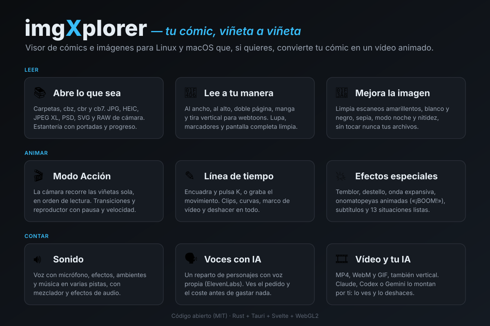
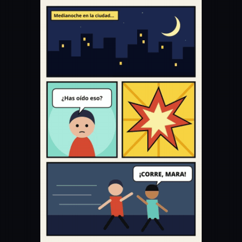

# imgxplorer

<p align="center"></p>

**imgXplorer — tu cómic, viñeta a viñeta.**

Visor de imágenes y cómics para **Linux y macOS** con un **Modo Acción**: animaciones de cámara (paneo, zoom, rotación) por imagen sobre una línea de tiempo, pensadas para leer cómics viñeta a viñeta y exportarlos a MP4.

> Estado: **versión 1.0.0 publicada** el 21 de noviembre de 2026. Se descarga en [imgxplorer.app](https://imgxplorer.app) y en [GitHub Releases](https://github.com/idNull/ImgXplorer/releases/latest). Lo que trae está en [CHANGELOG.md](CHANGELOG.md) y lo que falta comprobar en los tres equipos, en [docs/lista-comprobacion.md](docs/lista-comprobacion.md). Este README se actualiza con cada cambio.





*El GIF lo ha exportado la propia app a partir de una página de demostración original ([docs/img/demo](docs/img/demo), de dominio público, CC0).*

## Funciones

### Visor

- **Fuentes**
  - Carpetas, recorridas de forma recursiva.
  - Cómics y comprimidos: `zip`/`cbz`, `7z`/`cb7`, `rar`/`cbr`, y las historias `.imgxstory` (ver «Compartir una historia»).
  - Imágenes sueltas: al abrirlas se abre su carpeta, situada en esa imagen.
- **Orden natural** (`pagina 2` va antes que `pagina 10`). Se respetan las subcarpetas (capítulos) y se ignoran los archivos ocultos y `__MACOSX`.
- Se abren desde el botón **📂 Abrir ▾** de la cabecera (un menú con *Abrir archivo*, *Abrir carpeta*, *Crear cómic con imágenes* y *Organizar páginas*), desde las tarjetas de la pantalla de inicio, arrastrando o desde la línea de comandos: `imgxplorer <carpeta|cómic|imagen>`.
- **Tus propios cómics** (➕ *Crear cómic*, `Ctrl+N`): para quien tiene imágenes sueltas (hechas con una IA, escaneadas a su manera, fotos…) y no quiere preparar una carpeta o un zip con los nombres justos.
  - Eliges las imágenes (varias a la vez, o arrastrándolas a la ventana), les pones un nombre y pulsas *Crear*. Se **copian** en una carpeta nueva, `Imágenes/imgxplorer/<nombre>` (`~/Pictures/imgxplorer` en el Mac; se cambia en Ajustes → General), y el cómic se abre y queda en la estantería. Las imágenes originales no se tocan.
  - Las páginas se llaman `0001 - nombre original.png`: el número fija el orden y sigues reconociendo cada imagen. Es una carpeta normal: se puede mover, comprimir o abrir con cualquier visor.
  - **Ordenar**: arrastra una miniatura de la tira a otro sitio (se guarda al soltar, con aviso *Deshacer*) o abre la **mesa de luz ▦** (`Ctrl+Mayús+G`, o el botón ▦ al final de la tira): todas las páginas en grande, arrastrar para ordenar (una línea marca dónde caen), elegir varias con `Ctrl`/`Mayús`, **añadir imágenes delante o detrás** de la elegida, *Ordenar por nombre* (2 antes que 10), quitar y deshacer o rehacer. Con el teclado: flechas para elegir, `Alt`+flechas para mover, `Supr` para quitar.
  - Al ordenar, **la animación, los efectos, los sonidos y los marcadores siguen a su página**. Las páginas quitadas van a la carpeta oculta `.quitadas` del cómic (no se borran).
  - Soltar varias imágenes sobre la ventana pregunta si crear un cómic con ellas; soltarlas con un cómic propio abierto, si añadirlas detrás de la página actual.
  - Un CBZ, un CBR o una carpeta cualquiera **nunca se cambia**: en ellos, la mesa de luz termina con *Crear cómic con este orden*, que hace una copia ordenada con su animación.
  - Detalles: [docs/format.md](docs/format.md#cómics-propios).
- **Selector de archivos propio** para abrir y guardar: accesos a tus carpetas y unidades montadas, ruta editable, archivos ocultos y aviso antes de reemplazar. Se maneja con el teclado (flechas, `Intro` para entrar o aceptar, `Retroceso` para subir, letras para saltar, `Esc` para cancelar). Existe porque en algunos escritorios Linux (Hyprland/Omarchy…) el diálogo del sistema sale sin botón de Aceptar.
- **Recientes**: lo último que has abierto aparece en la pantalla de inicio y en el menú 🕘 (`Ctrl+R`). Al volver a abrir un cómic o una carpeta, se va a la imagen en la que lo dejaste (salvo que abras una imagen concreta). Los que ya no existen salen tachados.
- **Estantería** (pantalla de inicio): los mismos recientes con su **portada** y su progreso. El interruptor «▦ Portadas · ☰ Lista» vuelve a la lista de siempre y se recuerda.
  - Una tarjeta grande **«Continuar leyendo»** con el último cómic: página, porcentaje y un botón para seguir.
  - Rejilla de portadas con título, barra de progreso y «hace 2 días».
  - La portada es la primera página. Se hace sola la primera vez que abres algo (y, para lo que ya estaba en la lista, la primera vez que se ve la estantería), en segundo plano, y se guarda en la caché de la app (`~/.cache/com.imgxplorer.app/covers/` en Linux). No toca el cómic.
  - Lo que ya no existe sale en gris con «No encontrado».
  - Clic derecho: abrir, **abrir su carpeta** o **quitar de la lista** (también con la ✕ al pasar el ratón).
  - Con más de 12, un **buscador** y orden por recientes, nombre o progreso.
  - Siguen los botones para abrir y se puede arrastrar algo a la ventana, como siempre.
- **Ayuda de atajos** (`?` o `F1`): una ventana con todos los atajos agrupados (moverse, zoom, lectura, la imagen, Modo Acción, archivos, reproducción, editor y ratón) y un buscador. Sale de la lista de atajos de la app, así que enseña los que hayas cambiado. «Cambiar atajos…» lleva a Ajustes → Atajos. También está en el menú del clic derecho y en la pantalla de inicio.
- **Pantalla completa limpia** (`F11`): la cabecera y las miniaturas flotan sobre la imagen y se esconden a los 2 s sin mover el ratón; vuelven al acercarlo al borde de arriba o de abajo, y el puntero también se esconde. `Esc` sale de la pantalla completa. Con el editor abierto las barras se quedan. Se desactiva en Ajustes («Ocultar las barras en pantalla completa») para volver a lo de antes.
- **Primer uso guiado**: la primera vez, siete pasos señalan dónde está cada cosa: abrir un cómic, crear y ordenar el tuyo, pasar las páginas, 🎨 y 📖, Modo Acción, el editor y exportar o compartir. Se puede saltar, moverse con las flechas y repetir desde Ajustes → Acerca de. Quien vio la visita de una versión anterior recibe una vez un aviso de novedades para verla otra vez.
- **Cabecera adaptable**: con un tamaño de ventana normal se ven todos los botones. Si la ventana es tan estrecha que no caben, los que no caben pasan a un menú «⋯» con sus atajos (primero Exportar, Editor y Modo Acción), en vez de cortarse o partirse en dos líneas.
- **Cerrar** (botón ✕ junto al título o `Ctrl+W`): cierra lo que estás viendo y vuelve a la pantalla de inicio con los recientes.
  - Las animaciones se guardan solas medio segundo después de cada cambio, así que normalmente cierra sin preguntar.
  - Si una grabación está en curso, la termina y la guarda.
  - Solo avisa si el guardado ha fallado (sin permiso, disco lleno…): dice cuántos cambios se perderían y por qué, y deja reintentar, cerrar sin guardar o cancelar.
  - El mismo aviso sale al abrir otro archivo o al cerrar la ventana. Al cerrar la ventana, además, se espera a que se guarde el último cambio.
  - El historial de deshacer es de la sesión: al cerrar o abrir otro archivo empieza de cero, pero lo hecho ya está guardado.
- **Comprimidos sólidos** (7z/rar): al leer una página se guardan también las siguientes, para que pasar páginas sea fluido.
- **Render WebGL2** con mipmaps y filtrado anisótropo.
  - Zoom suave al cursor o al punto del pellizco.
  - Rotación en pasos de 90°.
  - Imágenes más grandes que el máximo de la GPU: se dividen en teselas (p. ej. panorámicas de 20000 px).
- **Precarga** de las imágenes vecinas y caché limitada por memoria.
- **Tira de miniaturas** con carga perezosa, siempre centrada en la imagen actual, en tres tamaños.
- **Ajustes de imagen (🎨, `J`)**: un panel flotante pequeño que no toca tus archivos.
  - Un clic: **Original**, **✨ Limpiar escaneo** (blanquea el papel amarillento y oscurece la tinta; la app analiza cada página), **Blanco y negro** y **Sepia**.
  - **🌙 Noche** (`N`): para leer con poca luz sin deslumbrar. Es solo para leer: no sale en el vídeo.
    - **🕯️ Cálido** (de serie): la imagen sigue tal cual, pero más tenue y cálida: el blanco del papel baja, se quita luz azul y el color pierde algo de fuerza; los negros no cambian, así el texto se lee igual. Con **intensidad** ajustable.
    - **🌗 Invertido**: el papel pasa a oscuro y la tinta a clara. Para páginas de texto; en un dibujo a color parece un negativo.
  - **Más ajustes**: brillo, contraste, saturación, tonos medios, temperatura y nitidez (doble clic en un deslizador lo devuelve a 0).
  - Para **esta página** o para **todo el cómic**; una página con ajustes propios usa los suyos.
  - Mantén `\` pulsada para ver el original. Un punto en 🎨 avisa de que la imagen se ve retocada.
  - Se guardan en el proyecto `.imgx`, se deshacen con `Ctrl+Z` y salen igual en la reproducción, en las capturas de la IA y en el vídeo (se puede desactivar al exportar).
- **Lectura (📖, `Ctrl+B`)**: un menú para leer cómics, manga y webtoons. Se recuerda **por cómic** (en `reading.json`, junto a los ajustes; no toca el cómic ni su `.imgx`). Un punto en 📖 avisa de que no es el modo de siempre.
  - **Ajustar a**: la **ventana** (como siempre), el **ancho** (`W`) o el **alto** (`H`). Pulsar otra vez `W` o `H` vuelve a la ventana. «Ajustar» (`0`/`F`) encuadra según el modo elegido.
    - Al ancho, avanzar (`Espacio`, `AvPág`, `↓`) recorre la página de arriba abajo y solo al llegar al final pasa a la siguiente. Al volver atrás, la página anterior aparece por su final.
    - Al alto, igual pero de lado a lado (en manga, de derecha a izquierda).
  - **✂ Ajustar al contenido**: el encuadre ignora los márgenes en blanco de la página (los detecta Rust una vez por página, sin contar el número de página). No recorta el archivo.
  - **Páginas**: **una**, **doble** (`2`) o **tira** vertical (`V`).
    - Doble página: dos páginas juntas, como un libro abierto, con la casilla «Portada sola». Las páginas apaisadas (que ya son dobles) se ven solas y luego se vuelve a emparejar. El zoom, el desplazamiento y la lupa funcionan sobre las dos.
    - Tira vertical (webtoon, manhwa): las páginas una debajo de otra con desplazamiento continuo. La rueda desplaza y `Ctrl` + rueda (o el pellizco) hace zoom; doble clic acerca o vuelve. El contador sigue a la página del centro. Al ancho, la tira ocupa toda la ventana.
    - Si al abrir algo las páginas son muy altas (más de 2,5 veces su ancho), se ofrece leerlo como webtoon. Se pregunta una sola vez por cómic.
  - **Sentido**: occidental o **manga** (de derecha a izquierda). En manga, `←` avanza y `→` retrocede, la doble página se ordena de derecha a izquierda y la barra de progreso se llena desde la derecha.
  - Los modos de lectura son para leer: con el editor, el panel del Modo Acción o durante la reproducción se ve una página como siempre.
- **🔍 Lupa**: mantén pulsada `Z` o el botón derecho y aparece un círculo ampliado ×2,5 que sigue al ratón (con los ajustes de imagen aplicados).
- **Menú de la imagen**: un clic corto con el botón derecho (mantenerlo es la lupa) abre las utilidades, cada una con su atajo:
  - **ℹ️ Información** (`I`): nombre, posición, tamaño en píxeles, peso, formato, subcarpeta y origen. Con fotos, los **datos de la cámara** (marca, modelo, objetivo, fecha, exposición, diafragma, ISO, focal…). Si la foto lleva su ubicación GPS, solo se avisa: no se enseña.
  - **📋 Copiar imagen** (`Ctrl+C`): al portapapeles, tal como se ve (con los ajustes de imagen).
  - **💾 Guardar imagen como…** (`Ctrl+S`): la **página entera**, **lo que se ve** o la **zona elegida**, como el **original** (copia exacta del archivo, también desde un comprimido), **PNG** o **JPEG**, con o sin los ajustes de imagen. Se dibuja a tamaño real (el lado mayor, hasta 8192 px).
  - **✂ Recortar**: `Mayús` + arrastrar elige una zona (por ejemplo, una viñeta). Aparece una barra para copiarla o guardarla; `Esc` la quita.
  - **📂 Mostrar en la carpeta**: abre el gestor de archivos en la imagen (en un comprimido, en el comprimido).
  - **🗑 Mover a la papelera** (`Supr`, solo imágenes de una carpeta): pregunta antes y la manda a la papelera del sistema, de donde se puede recuperar. Con el editor abierto, `Supr` sigue siendo para borrar lo seleccionado en él.
- **Ir a página** (`Ctrl+G`): escribe el número e `Intro`.
- **Marcadores** (`B`): marca o desmarca la página. Salen con 🔖 en las miniaturas, como muescas en la barra de progreso y en el menú 📖, donde un clic salta a cada uno.
- **Barra de progreso**: una línea fina abajo del visor que muestra cuánto llevas. Al pasar el ratón dice «12 / 48» y un clic salta a ese punto. Se oculta desde el menú 📖.
- **Entrada**
  - Ratón: rueda para zoom y arrastrar para desplazar.
  - Touchpad: dos dedos para desplazar y pellizco para zoom (GTK en Linux, gestos nativos en macOS).
  - Teclado: atajos de la tabla de abajo.

### Ajustes

Botón ⚙ o `Ctrl+,`. Todo se aplica y se guarda al momento.

- **Idioma**: español, inglés o el del sistema. Cambia sin reiniciar: toda la app, también los diálogos abiertos y los mensajes de error que vienen del motor. `pnpm check` comprueba que los dos idiomas tienen los mismos textos.
- **Fondo del visor**: oscuro, negro, gris, gris claro o cualquier color.
- **Miniaturas**: mostrar u ocultar la tira y su tamaño.
- **Zoom**: cuánto acerca cada paso con teclado y botones, y la velocidad de zoom con la rueda.
- **Retomar**: volver a la imagen en la que lo dejaste (se puede desactivar).
- **Selector de archivos**: el de imgxplorer, el del sistema o automático (el propio en Linux y el del sistema en macOS).
- **Diagnóstico**: mostrar u ocultar el panel.
- **Pantalla completa**: ocultar o no las barras solas.
- **Acerca de**:
  - Versión, autor y con qué se ha hecho (tecnologías y Claude Code).
  - La licencia (MIT), con su texto.
  - **Agradecimientos especiales** a los amigos y colaboradores que han ayudado (probando la app, dando ideas…). Se añaden en `ui/src/lib/about/thanks.ts`, con su nombre y, si se quiere, qué hicieron.
  - **Menciones de honor**: personas que han inspirado el proyecto sin participar en él. Están en el mismo archivo, en la lista `HONOR`.
  - **Licencias de terceros**: todas las bibliotecas que usa la app, agrupadas por licencia, con sus autores, un buscador, el texto de cada licencia y un enlace a la página de cada proyecto. Arriba van los avisos especiales: UnRAR, libheif y sus decodificadores, FFmpeg y WebKit.
  - «Ver la visita guiada» repite el primer uso guiado.
  - Una línea con los datos del sistema (versión, sistema, sesión y WebKitGTK) que se copia con un botón para informar de un problema.
- **Voces IA**:
  - **Proveedor**: ElevenLabs o simulado (para probar sin gastar).
  - **Clave de la API**: se pega una vez y se guarda en el **llavero del sistema** (Secret Service en Linux, Llavero en macOS). Si no hay llavero, va a un archivo que solo puede leer tu usuario. Nunca se enseña ni va en el proyecto, en los registros o a una IA.
  - **Probar conexión**: plan, caracteres usados y los que quedan.
  - **Modelo de voz** (Eleven v3 de fábrica, v4, Multilingual v2 o Flash v2.5, a mitad de precio), **tope por sesión** y cuánto puede gastar una IA **sin preguntar** (0 de fábrica: siempre pregunta).
- **Atajos**: cada acción admite hasta 3 teclas. Pulsa `+` y luego la tecla. Si ya la usaba otra acción del mismo grupo, se le quita y se avisa. Se pueden restablecer una a una o todas.

Los ajustes, los recientes y el modo de lectura y los marcadores de cada cómic (`reading.json`) se guardan en `~/.config/com.imgxplorer.app/` (Linux) o `~/Library/Application Support/com.imgxplorer.app/` (macOS).

### Modo Acción

Animaciones de cámara para leer cómics viñeta a viñeta o presentar imágenes. Se abre con el
botón 🎬 o la tecla `A`.

- **Plantillas**, para todas las imágenes o solo para la actual:
  - **Cómic por viñetas**: recorre las viñetas en orden de lectura, de derecha a izquierda (manga) o de izquierda a derecha.
    - Viñetas **detectadas automáticamente** (calles blancas o negras) o por **rejilla** de filas × columnas.
    - Una viñeta alta que ocupa dos filas se lee en su sitio.
    - Las viñetas se ven numeradas sobre la página mientras se ajusta la plantilla.
    - Si una página no tiene viñetas claras (ilustración a página completa), se usa la rejilla.
    - **Corregirlas a mano** ("Editar viñetas"): arrastra en la página para dibujar una, arrástrala para moverla o usa sus tiradores para cambiar el tamaño; `Supr` la borra. Las dibujadas a mano sustituyen a la detección en esa imagen y se pueden devolver a la automática.
  - **Desplazamiento**: ajusta al ancho (o al alto) y recorre la imagen, para webtoons y panorámicas.
  - **Rebote**: ciclos de acercar y alejar subiendo y bajando.
  - **Ken Burns** e **imagen completa**.
  - Cada parámetro (tiempos, márgenes, zoom máximo, curva…) se ajusta con su control.
- **Transiciones** entre imágenes: corte, fundido, deslizar y **cámara continua** (las páginas se colocan juntas y la cámara viaja de una a otra), con duración y pausa al final.
- **Reproductor interactivo**:
  - Pausa, pasos (inicio de cada movimiento), ±1 s, imagen anterior o siguiente, velocidad de 0,5× a 2×.
  - Si haces zoom o mueves la imagen a mano, la animación se detiene; un segundo después de soltar, la cámara vuelve sola a donde estaba y sigue.
  - Si cambias el tamaño de la ventana, los encuadres se recalculan. Los cambios de plantilla o de parámetros se aplican al momento, también mientras se reproduce.
- **Deshacer y rehacer** (`Ctrl+Z` / `Ctrl+Mayús+Z`) cualquier cambio del Modo Acción y del editor; un arrastre completo cuenta como un solo paso.
- **Guardado automático** en un archivo `.imgx` junto al original (`Tomo 1.cbz.imgx`, o `.imgxplorer.imgx` dentro de la carpeta). Si ahí no se puede escribir, va al directorio de datos de la app. Un archivo de una versión más nueva no se sobrescribe.

### Editor de línea de tiempo

Para hacer la animación de una imagen a medida. Se abre con el botón ✎ o la tecla `E` y aparece
debajo de la imagen: biblioteca a la izquierda, pista de cámara en el centro e inspector a la derecha.
La biblioteca y el inspector se ensanchan arrastrando su borde (doble clic o el botón ↔ ajustan la
biblioteca a los nombres largos).

- **Marco** (▭, arriba en el editor): el visor se estrecha a la proporción final y lo que ves dentro del recuadro ámbar es exactamente lo que se verá.
  - *Reproducción* (de fábrica): la del visor al reproducir (el editor se oculta y el visor crece, así que sin marco el encuadre cambiaría).
  - *Vídeo*: la del vídeo que vas a exportar (por ejemplo 1080×1920 en vertical).
  - *Sin marco*.
- **Claves con la vista actual** (`K`): encuadra la imagen con el ratón, el touchpad o el teclado y pulsa `K`. La clave se guarda en el cabezal; si estás al final, el cabezal avanza 1 s para la siguiente. Pulsar `K` sobre una clave existente la sustituye.
- **Grabar** (`G`): graba el movimiento real de la cámara mientras lo haces y lo guarda como clip ("Grabación 1"…). Se suaviza el temblor y se simplifica sin perder el ritmo. `G` o `Espacio` terminan, `Esc` descarta.
- **Pista de cámara**:
  - Arrastra un clip para moverlo y sus bordes para estirarlo (cambia la velocidad); con `Mayús`, los bordes recortan.
  - Las claves (◆) se arrastran por el tiempo sin pasar a sus vecinas.
  - Todo se pega al cabezal, a los bordes de otros clips y a las claves.
  - Si dos clips se solapan, manda el que empieza después; cuando termina, sigue el de debajo.
  - Rueda del ratón para moverse por la pista y `Ctrl+rueda` (o `−` `+`) para acercarla.
  - Las pistas de voz, efectos y ambiente aparecen ya, desactivadas, para la fase de sonido.
- **Cabezal**: clic o arrastre en la regla para ver cada momento; `,` y `.` saltan a la clave anterior o siguiente; `Espacio` reproduce la vista previa de la imagen.
- **Inspector**:
  - De un clip: nombre, inicio, duración, velocidad, recortes; guardarlo en la biblioteca, duplicarlo o borrarlo. En las esperas, fijar la vista actual o mantener la anterior.
  - De una clave: instante, **curvas** y la pose exacta (x, y, zoom, giro); "Usar la vista actual" la cambia por lo que se ve.
  - Cada clave tiene dos curvas: la de **llegada** (cómo se viene desde la clave anterior) y la de **salida** (cómo se va a la siguiente). Opciones: lineal, suave, acelerando, frenando, rebote, elástico, salto o Bézier con sus 4 valores. Cada una se dibuja con una explicación breve, y en la pista se ve la forma de la curva de cada tramo; al elegir una clave se resaltan sus dos tramos.
- **Plantillas y editor**: si la imagen usa una plantilla, el editor muestra su animación (con borde discontinuo). Al editarla (añadir una clave, grabar, mover un clip…) se convierte en clips propios de esa imagen, que mandan sobre las plantillas. "Quitar la animación propia" vuelve a la plantilla.
- **Biblioteca**:
  - Clips de fábrica (acercar, alejar, paneos, balanceo, esperas) y los tuyos. Arrástralos a la pista o pulsa `+` para añadirlos al final. Doble clic para renombrar.
  - Plantillas propias: guarda la plantilla de una imagen con sus parámetros y aplícala luego a una imagen o a todas.
  - **Exportar e importar** clips y plantillas en paquetes `.imgxpack` para compartirlos. También se importan soltando el archivo sobre la ventana. Al importar no se duplica lo que ya tienes.
  - Se guarda en `~/.local/share/com.imgxplorer.app/library.json` (Linux) o `~/Library/Application Support/com.imgxplorer.app/` (macOS).

### Efectos especiales

Temblores, destellos, ondas expansivas y recursos del manga colocados en la línea de tiempo de cada imagen, como los sonidos. Se ven igual en el editor, al reproducir y en el vídeo.

- **Añadir**: botón **✨ Efecto aquí** del editor (en el cabezal), el **+** de la fila *✨ Efectos*, o **✨ Efecto aquí** en el inspector de una clave (justo en ese instante).
- **Situaciones listas**: varios efectos ya sincronizados y, si quieres, su sonido de serie en una pista de efectos y su **onomatopeya** (casilla «Con su onomatopeya»: Explosión → «¡BOOM!», Puñetazo → «¡POW!», Disparo → «¡BANG!», Sorpresa → «!?», Terremoto → «BRRRR», Velocidad → «¡ZAS!»). Con `Ctrl+Z` se deshace todo junto.

  | Situación | Qué pone | Sonido |
  |---|---|---|
  | 💥 Explosión | Destello, onda expansiva, temblor fuerte y glitch | Explosión |
  | 👊 Puñetazo | Golpe de zoom, temblor corto y fotograma en negativo | Puñetazo |
  | 💢 Disparo | Destello corto y temblor mínimo | Disparo |
  | 🌩 Rayo | Relámpago y negativo | Trueno |
  | 🌍 Terremoto | Temblor largo y desenfoque | — |
  | 📢 Grito | Onda, temblor y líneas de concentración | — |
  | 💨 Velocidad | Líneas de velocidad y desenfoque radial | Silbido |
  | ❗ Sorpresa | Líneas de concentración y golpe de zoom | Ding |
  | 😱 Miedo | Viñeta que late y color frío | Latido |
  | 🕰 Flashback | Sepia, bordes oscuros y ondulación al entrar | — |
  | 💭 Sueño / mareo | Ondulación, desenfoque y gris | — |
  | ✨ Poder | Aberración que pulsa, onda y destello | — |
  | 💔 Daño | Destello rojo, temblor y glitch | Golpe |

- **Efectos sueltos** (cada uno con ajustes predefinidos y sus mandos): 〰 temblor, 🔍 golpe de zoom, ⚡ destello, ◎ onda expansiva, 🌈 aberración / glitch (el rojo y el azul se separan en toda la imagen, más hacia los bordes; el glitch rompe la imagen en franjas de alto variable con los colores aún más separados), 💫 desenfoque radial, ✳ líneas de concentración, ≡ líneas de velocidad, ◐ fotograma de impacto, 🎨 color (sepia, gris, frío, cálido, tinte), ◯ viñeta y 🌊 ondulación.
- **💥 Onomatopeyas animadas**: letras de cómic («¡KABOOM!», «¡ZAS!») sobre la imagen, con la fuente Bangers (incluida, licencia SIL OFL).
  - Texto, color, contorno, tamaño, giro y animación: **aparecer de golpe**, **temblar**, **crecer**, **con rebote** o **entrar de lado**. Se desvanecen al final.
  - Van pegadas a su punto (**⌖ Elegir**): se mueven con la cámara, tiemblan con el temblor y les afectan el destello, el color o el negativo, como al dibujo.
  - Ajustes listos: ¡BOOM!, ¡POW!, ¡BANG!, ¡ZAS!, !? y BRRRR.
- **💬 Subtítulos y textos**: texto fijo en la pantalla que no tiembla, en tres estilos: **subtítulo** (abajo, con contorno, parte las líneas largas), **cartel** (grande en el centro: «Mientras tanto…») y **narración** (cartela amarilla arriba a la izquierda, como en los cómics). Entran y salen con un fundido.
  - Al exportar se pueden guardar también como **`.srt`**, junto al vídeo, para subirlos a YouTube.
  - Están en la misma fila *✨ Efectos*, así que se mueven, se estiran y se deshacen como los demás.
  - El texto se escribe en el inspector y se aplica con **✓ Aplicar** (o `Ctrl+Intro`, o al salir del cuadro); mientras no se aplica, pone «Sin aplicar». Al cambiar de estilo (subtítulo, cartel o narración) o de ajuste, el texto se conserva y el tamaño y el color se adaptan al estilo. Igual en las onomatopeyas, salvo los ajustes que traen su propio texto («!?», «BRRRR»).
- **Editar**: en la fila *✨ Efectos* se arrastran y se estiran por los bordes, con ajuste magnético a claves, sonidos y otros efectos. El inspector tiene ajuste, intensidad, inicio, duración y mandos. `Supr` o `Retroceso` borran el efecto seleccionado (también justo después de mover uno de sus mandos).
- **Punto**: **⌖ Elegir** y un clic en la imagen marcan dónde ocurre (el centro de la explosión, el puño). Sigue a la imagen aunque la cámara se mueva.
- **Seguridad**: destellos y negativos no parpadean más de 3 veces por segundo.
- **Cómo funciona**: el núcleo en Rust (`crates/imgx-core/src/fx.rs`) calcula cada fotograma de forma determinista y el visor WebGL aplica el temblor a la matriz de cámara y el resto en una sola pasada de shader. Sin efectos activos, no cuesta nada.

### Voces con IA (ElevenLabs)

Pon voz a los personajes con una IA externa, [ElevenLabs](https://elevenlabs.io), usando tu propia cuenta. Lo generado son clips normales: se mueven, se recortan, llevan efectos de audio y salen en el vídeo.

- **Panel 🗣 Voces IA** del editor: botón 🗣 en la cabecera de la primera pista de voz o en el inspector cuando no hay nada seleccionado. Se abre en la columna del inspector, sin tapar la línea de tiempo. Tiene tres pestañas:
  - **Reparto**: los personajes, con su color, nombre, idioma y la **descripción de su voz** (edad, carácter, acento, forma de hablar).
    - **🎙 Crear voz**: ElevenLabs hace 3 muestras a partir de la descripción; las escuchas (▶) y eliges una, que queda guardada en tu cuenta y asignada al personaje.
    - **Elegir de mis voces**: cualquier voz de tu cuenta (de serie, diseñada o clonada).
    - **▶ Probar**: una frase corta con esa voz.
    - **Ajustes de la voz**: estabilidad, estilo y velocidad (doble clic vuelve al valor de fábrica).
    - Quitar un personaje pide una segunda pulsación.
  - **Guion** de la imagen: una fila por frase, en orden de lectura, con su personaje, su tipo y su texto.
    - Tipos: **💬 diálogo**, **💭 pensamiento** (con un poco de sala, como dentro de la cabeza), **📜 narración** y **👥 multitud** (gritos de fondo, un ejército: se genera como efecto en la pista de efectos, más bajo).
    - **Etiquetas de interpretación**: botones que insertan `[shouting]`, `[whispers]`, `[laughs]`, `[crying]`… donde está el cursor. Funcionan con los modelos Eleven v3 y v4.
    - Contador de caracteres, **⏱ inicio** (vacío: detrás de la frase anterior; ⌖ lo pone en el cabezal), ▲▼ para reordenar y 🗑 para borrar la frase con su clip.
    - Estado de cada frase: **borrador**, **generada** o **cambiada** (si cambias el texto, el personaje o su voz después de generarla).
    - **Revisar y generar** pide solo las frases nuevas o cambiadas. **↻ Otra toma** vuelve a pedir esa frase con otra interpretación.
  - **Sonidos**: **efectos** (0,5–30 s, con opción de bucle para ambientes) y **música** (3 s a 10 min, instrumental o no) a partir de una descripción. Van a la biblioteca de sonidos («Generados con IA») o directamente al cabezal.
- **Resumen del pedido**: antes de enviar nada se ve la lista exacta de fragmentos, con sus caracteres y el coste aproximado. Se puede quitar o retocar cualquiera, y lo **ya generado** sale gratis. Nada se envía sin pulsar «Generar».
- **Colocación**: cada frase queda como clip en la pista de voz, uno detrás de otro y sin pisarse, con el color de su personaje. La imagen dura lo que sus voces. Una toma nueva sustituye el sonido de su clip sin moverlo ni quitarle los efectos; si es más larga, las voces generadas que van detrás se corren lo justo.
- **Control del gasto**:
  - **Caché**: la misma frase con la misma voz, modelo y ajustes no se vuelve a pagar.
  - **Tope por sesión** de caracteres de voz (5000 de fábrica; 0 = sin tope).
  - La primera vez, un aviso de que los textos y las descripciones se envían a ElevenLabs.
- **Derechos de uso**: lo generado es tuyo, pero siguen las condiciones de ElevenLabs. Con el plan gratuito solo se permite uso no comercial, y la música hay que atribuirla a Eleven Music; para vídeos comerciales hace falta un plan de pago ([términos](https://elevenlabs.io/terms-of-use), [música](https://elevenlabs.io/music-terms)).
- **Modo simulado** (Ajustes → Voces IA → Proveedor): para probarlo todo sin internet ni gastar. Las «voces» son tonos con la duración que tendría la frase.
- **Todo se deshace** con `Ctrl+Z` y se guarda en el proyecto `.imgx` (el reparto y el guion; ver [docs/format.md](docs/format.md)). La clave nunca va en el proyecto.
- **Con tu IA** (Claude, Codex, Gemini): puede leer los bocadillos, crear el reparto, escribir el guion, estimar el coste y generar. Lo que gasta te enseña el pedido y espera a que aceptes (ver «Control por IA»).
- **Cómo funciona**: todas las llamadas a ElevenLabs las hace Rust (`src-tauri/src/voices/`), detrás de una interfaz `VoiceProvider` con dos proveedores: ElevenLabs y el simulado. La interfaz gráfica nunca sale a internet ni ve la clave.

### Exportar a vídeo

Botón 🎞 o `Ctrl+E`. Se exporta tal cual se reproduce: la animación de cada imagen, la pausa entre
imágenes y las transiciones, con el color de fondo del visor.

- **Qué**: la imagen actual, todas o un rango ("desde la 3 hasta la 8").
- **Formato**: **MP4** (H.264 y AAC, el de siempre), **WebM** (VP9 y Opus, más ligero, para la web) o **GIF** animado (sin sonido, a 15 fotogramas por segundo como mucho; se hace en dos pasadas con su propia paleta de colores, y la ventana avisa de que pesa mucho).
- **📱 Para redes (9:16)**: un clic pone el vídeo vertical a 1080 × 1920.
- **Subtítulos**: si hay, casilla para guardar también el `.srt` al lado del vídeo.
- **Tamaño**: 720p, 1080p, 1440p o 4K, en horizontal (16:9), vertical (9:16, para móvil) o cuadrado; o a medida.
- **Fotogramas por segundo**: 24, 30 o 60. **Calidad**: alta, normal o ligera.
- **Archivo**: se propone junto al cómic o la carpeta, con su nombre. Si ya existe se avisa.
- Barra de progreso con el tiempo que queda; se puede cancelar y el archivo a medias se borra.
- Las plantillas se recalculan para la forma del vídeo. Para encuadrar a mano con esa forma, usa el marco *vídeo* del editor.
- **Cómo funciona**: cada fotograma se pinta con el mismo motor WebGL de la vista previa (así sale idéntico), se convierte a YUV 4:2:0 en la GPU y se pasa por tubería a **ffmpeg** (H.264 en MP4 o VP9 en WebM, BT.709; el GIF sale del MP4 con `palettegen`). ffmpeg escribe en un archivo temporal que se renombra al terminar bien.
- **ffmpeg** es necesario y no viene incluido: se busca en el sistema (en macOS también en Homebrew) o se indica su ruta en la propia ventana. Si falta, la ventana explica cómo instalarlo (`sudo pacman -S ffmpeg`, `sudo apt install ffmpeg`, `brew install ffmpeg`). Usa `libx264` si está; si no, `h264_videotoolbox` (macOS) u `libopenh264`.

### Compartir una historia (.imgxstory)

En la misma ventana de 🎞 Exportar, pestaña **📦 Historia** (o `Ctrl+Mayús+E`). Guarda el cómic con su animación en **un solo archivo** para compartirlo: quien lo reciba lo abre en imgxplorer y lo ve tal cual lo preparaste, sin pasarlo a vídeo.

- **Qué lleva**:
  - las páginas;
  - la animación (cámara, transiciones, efectos, onomatopeyas y subtítulos);
  - **todos los sonidos y voces** que usa: grabaciones, importados y los de ElevenLabs. Los de serie no hacen falta, porque los fabrica la app.
- **Para qué**: dos variantes del **mismo formato**; las dos se abren en el escritorio y, en el futuro, en el móvil.
  - **🖥 Escritorio**: páginas con su calidad original. Las que están en formatos que un móvil no sabe abrir (HEIC, RAW, PSD, TIFF…) se convierten sin pérdida.
  - **📱 Móvil**: páginas de 2.560 px como mucho, así que pesa mucho menos.
- **Qué exportar**: todo, la imagen actual o un rango (los ambientes se recortan a ese rango).
- **Título y créditos** opcionales: quién la ha hecho, las voces, la música…
- **«Incluir las tomas anteriores»** de las voces: solo hace falta si quien la recibe va a seguir editándolas.
- **Avisos**:
  - las páginas son del autor del cómic, así que compartir la historia es compartir el cómic;
  - si lleva sonidos de ElevenLabs, con su plan gratuito solo valen para uso no comercial, y la música hecha con el plan gratuito hay que atribuirla a Eleven Music.
- **Mientras se crea**: con barra de progreso y cancelable (no queda ningún archivo a medias). Al terminar dice cuántas páginas y sonidos lleva, cuánto pesa y si faltaba algún sonido.
- **Abrirla**: como cualquier cómic (Abrir, arrastrar, doble clic o la estantería).
  - Se usa el modo de lectura con el que se pensó (manga, doble página, webtoon…) la primera vez.
  - Sus sonidos suenan desde dentro del archivo, sin copiarse a tu biblioteca. En el editor salen con 📦, y **⤓ Guardar en mi biblioteca** copia el que quieras.
  - **Se puede retocar**: los cambios se guardan al lado (`<historia>.imgxstory.imgx`), y la historia original no cambia.
- **También desde la estantería**: clic derecho → «📦 Compartir historia…».
- **El formato** está explicado en [docs/imgxstory.md](docs/imgxstory.md), y es el que usará la futura versión para el móvil.

### Sonido

Cada imagen puede llevar **voz** y **efectos**, y el proyecto, **ambientes o música** que suenan de una imagen a otra. Se oye al reproducir en el Modo Acción y en el editor, y sale en el vídeo exportado.

- **Biblioteca de sonidos** (pestaña *Sonidos* del editor):
  - **Tuyos**: importa mp3, wav, flac, ogg o m4a con *Importar sonido* o arrastrando los archivos a la ventana. Se **copian** a tu biblioteca, así que no se rompen si mueves o borras el original. El mismo archivo importado dos veces es el mismo sonido.
  - **Grabaciones**: las voces grabadas con el micrófono.
  - **Generados con IA**: voces, efectos y música de ElevenLabs (ver «Voces con IA»).
  - **De serie**: 14 efectos que fabrica la propia app por síntesis, sin descargas ni licencias. Hay lluvia, viento, oleaje, latido, trueno, golpe, puñetazo, zas, explosión, llamar a la puerta, pasos, campana, timbre y disparo. Los marcados con 🔁 están pensados para sonar en bucle.
  - ▶ para escuchar, doble clic para renombrar y ✕ para quitarlo de la biblioteca (el archivo original no se toca).
- **Pistas**: hay tres grupos (**voces**, **efectos** y **ambiente**) y en cada uno puedes tener **varias pistas** («Voz Ana», «Voz Luis», «Golpes»…), las mismas en todas las imágenes, como en un programa de audio. Así se mezclan varios sonidos a la vez sin salir de la app.
  - **＋** en la cabecera de la última pista de un grupo añade otra. Doble clic en el nombre la renombra.
  - **M** silencia la pista (tampoco sale en el vídeo) y **S** deja solo esa mientras editas (no se guarda ni afecta al vídeo).
  - Al pulsar la cabecera, el inspector muestra su **volumen**, **panorama** (izquierda/derecha), sus **efectos de audio**, el orden dentro del grupo y *Borrar pista*. Borrar una pista borra lo que suena en ella (avisa de cuántos sonidos son) y se puede deshacer. Cada grupo conserva al menos una pista.
  - Con muchas pistas, la zona de pistas se desplaza en vertical: rueda sobre los nombres o `Mayús` + rueda. La altura del editor se cambia arrastrando su borde superior (doble clic la devuelve a la normal).
  - Los proyectos de antes tienen una pista por grupo y se abren igual.
- **Clips de sonido**: arrastra un sonido a la fila de la pista que quieras (o pulsa **+** en la biblioteca para ponerlo en el cabezal, en la última pista usada). Cada clip muestra su forma de onda y se mueve con ajuste magnético a claves y otros clips; arrastrándolo hacia arriba o abajo cambia de pista dentro de su grupo.
  - Sus bordes recortan: el izquierdo salta el principio del sonido y el derecho lo acorta.
  - En el inspector se ajustan el inicio, la duración, el recorte, el **volumen** (hasta el 200 %), los **fundidos** de entrada y salida, la **pista** (también de voz a efectos o al revés) y los **efectos de audio del propio clip**. Desde ahí también se duplica o se borra.
  - Todo entra en deshacer y rehacer.
  - **La imagen dura al menos lo que su sonido**: la voz nunca se corta. La cámara se queda en su última pose hasta que acaba.
  - El sonido no depende de la cámara: una imagen puede usar una plantilla y tener su propia voz.
- **Grabar voz** (botón 🎙 *Voz* o `V`): graba del micrófono mientras la animación avanza desde el cabezal.
  - Muestra el nivel (en rojo si es demasiado alto) y los segundos grabados.
  - `V` o `Espacio` terminan, y `Esc` descarta.
  - La grabación se guarda en tu biblioteca («Voz 1»…) y se coloca en la pista de voz seleccionada (o en la primera); el medidor aparece en su cabecera.
  - Mientras grabas, el sonido se silencia para que el micrófono no lo recoja.
  - El micrófono se elige en los ajustes. En macOS, la primera vez el sistema pide permiso.
- **Ambientes y música** (sección *Sonido* del Modo Acción): elige un sonido y *Añadir*.
  - Suena desde la imagen actual hasta la última, en bucle; luego se cambia *desde* y *hasta*, el volumen y los fundidos.
  - También se puede soltar un sonido en una pista de ambiente del editor, y entonces suena en esa imagen. Cada ambiente puede ir en su propia pista y llevar sus efectos.
  - Al pasar de una imagen a otra del tramo, el ambiente **no se corta**: solo se funde al entrar y al salir.
  - **Borrar** (`Supr` o `Retroceso` con la barra del ambiente seleccionada en el editor, o los botones del inspector):
    - En la imagen donde **empieza**, se borra de **todas** las imágenes en las que suena.
    - En una de las **siguientes**, se quita **solo de esa imagen**: el tramo se acorta o se parte en dos (por ejemplo, de la 2 a la 9 quitando la 5 queda 2–4 y 6–9). El inspector dice de qué imagen viene y cuántas abarca.
    - **Que acabe aquí** lo corta en la imagen actual, y **Borrar en las N imágenes** lo borra entero desde cualquiera.
    - Todo se deshace con `Ctrl+Z` en un solo paso.
  - Si mueves la cámara a mano, la voz y los efectos se congelan con la imagen, pero el ambiente sigue.
- **Mezclador** (sección *Sonido* del Modo Acción): volumen de cada grupo (voces, efectos y ambiente) y, debajo, de cada una de sus pistas, con **M** y **S**. Opción para **bajar el ambiente mientras hay voz** (de las pistas que no estén silenciadas), que se calcula según dónde están los clips de voz, así que suena igual en directo que en el vídeo.
- **Efectos de audio**, en una pista (afectan a todo lo que suena en ella) o en un clip concreto (solo a ese sonido; los de la pista se aplican después). Cada uno tiene ajustes predefinidos y mandos para afinar (doble clic en un mando lo devuelve a su valor), se enciende y apaga, y se reordena con ▲▼:

  | Efecto | Ajustes predefinidos | Mandos |
  |---|---|---|
  | ⛪ Reverb | Habitación, sala, catedral, cueva, baño | Tamaño, amortiguación, mezcla, anchura, retardo inicial |
  | 🔁 Eco | Corto, eco, montaña, ping-pong | Tiempo, repeticiones, brillo, mezcla, ping-pong |
  | 🎚 Ecualizador | Más cuerpo, más claridad, sin graves | Graves, medios y agudos (±12 dB) |
  | 📞 Filtro | Teléfono, radio, megáfono, bajo el agua, lejos, tras la pared | Quita graves, quita agudos, saturación |
  | 🗜 Compresor | Voz, suave, fuerte | Umbral, proporción, ataque, liberación, ganancia |
  | 🎵 Tono | Monstruo, grave, agudo, ardilla | Semitonos (±12, sin cambiar la velocidad), mezcla |
  | 🤖 Robot | Robot, alien, metálico | Frecuencia, metal, mezcla |
  | ⚡ Distorsión | Suave, fuerte, radio rota | Intensidad, brillo, mezcla |

  Las colas (la reverb de una cueva, las repeticiones de un eco) siguen sonando al pasar a la imagen siguiente, igual en directo que en el vídeo.
- **Velocidad**: a 0,5×–2× la voz y los efectos aceleran o frenan cambiando el tono (como una cinta); el ambiente no cambia.
- **Silenciar**: botón 🔊 de la barra de reproducción o `M`. En los ajustes están el **volumen general** y el **micrófono**.
- **En el vídeo**: casilla *Incluir el sonido* al exportar.
  - Se mezcla con el mismo mezclador que suena en directo, a 48 kHz.
  - Se añade al MP4 en AAC (192 kbps) con una segunda pasada rápida de ffmpeg que copia el vídeo sin volver a codificarlo.
- **Paquetes `.imgxpack`**: además de clips y plantillas, llevan tus sonidos. Al importarlos se añaden a tu biblioteca y se comprueba que cada archivo es lo que dice ser.
- **Cómo funciona**: el sonido lo produce un motor propio en Rust (`crates/imgx-audio`), no el navegador interno.
  - Decodifica con `symphonia`, en Rust puro y sin GStreamer.
  - Mezcla con interpolación cúbica y sale por `cpal` (ALSA/PipeWire/Pulse en Linux, CoreAudio en macOS).
  - Los efectos (`crates/imgx-audio/src/fx`) son propios y deterministas: Freeverb, eco con realimentación filtrada, biquads, compresor, desplazador de tono granular, modulador en anillo y saturación. La misma mesa de mezclas (pistas → grupos → general) sirve para oír y para exportar, y una prueba comprueba que el directo y la exportación dan las mismas muestras.
  - La interfaz le manda qué suena en cada imagen y su reloj. Él lleva el suyo y lo corrige si se separa más de 50 ms, sin mandar una orden en cada fotograma.

### Control por IA (MCP)

Una IA puede montar el vídeo por ti: mira cada página y cada viñeta, les da el tiempo que pide su texto, diseña los movimientos de cámara, pone voces, efectos, ambiente y música, revisa el resultado y exporta el MP4.

- **Con qué IAs**: Claude Code, Codex (también desde la app de ChatGPT de escritorio, que usa su misma configuración) y Gemini CLI. Funciona con cualquier IA que admita servidores MCP locales.
- **Conectar**: *Ajustes → IA*. La app detecta qué IAs tienes y cada una tiene un botón **Conectar** (usa el comando oficial de cada IA; no hay que tocar archivos), **Probar** y **Quitar**.
  - También desde la terminal: `imgxplorer --mcp-install` (todas) o `imgxplorer --mcp-install claude|codex|gemini`, y `--mcp-uninstall`.
  - Los instaladores de Linux y Mac lo preguntan al final (solo si tienes alguna IA, y no hacen nada si no dices que sí).
  - Si la app cambia de sitio (otra versión del AppImage, reinstalada), la fila sale como «ruta antigua» con un botón **Actualizar**.
- **Permiso**: el control viene **apagado**; se enciende con *Permitir el control por IA* (o solo al conectar la primera IA). Apagado, ninguna IA puede tocar nada.
- **Mientras trabaja**: en la cabecera aparece **🤖 IA** con lo que va haciendo y un botón **Detener la IA**. Ves cada cambio en directo y todo se deshace con `Ctrl+Z`. Si la app está cerrada, la IA la abre.
- **Empezar**: abre una sesión nueva de tu IA y pídeselo con tus palabras, por ejemplo: «Usa imgxplorer para montar un vídeo de este cómic: ~/Cómics/capitulo1.cbz. Ritmo tranquilo, lluvia suave de fondo y efectos donde haya acción. Revisa y exporta en 1080p». En *Ajustes → IA* hay una frase de ejemplo para copiar.
- **Qué puede hacer** (59 herramientas):
  - **Montar el cómic**: crear tu propio cómic con imágenes sueltas (por ejemplo, las que ha generado una IA de imágenes) y ordenar, añadir o quitar sus páginas (`create_comic`, `arrange_pages`).
  - **Ver**: la página con las viñetas numeradas en orden de lectura (occidental o manga), cada viñeta a alta resolución para leer el texto, y corregir viñetas mal detectadas.
  - **Animar**: «planos de director» (viñeta, zona o página entera + segundos quieta + tiempo y curva de llegada + acercamiento lento); la app calcula las poses exactas para la forma del vídeo y quedan como keyframes normales, editables. También keyframes sueltos, plantillas y transiciones.
  - **Sonido**: biblioteca, buscar audio en la carpeta que le digas e importarlo, pistas, voces y efectos en el instante de cada plano, ambientes y música entre imágenes, efectos de audio y mezcla.
  - **Efectos especiales**: situaciones (explosión, puñetazo, sorpresa, flashback…) o efectos sueltos en el plano que toca y en el punto de la imagen donde ocurren, con sus **onomatopeyas** («¡BOOM!») y **subtítulos**, carteles o cartelas de narración.
  - **Voces con IA**: crear el reparto (una voz por personaje, descrita por su aspecto, o una de tu cuenta), escribir el guion de cada imagen con etiquetas de interpretación y su momento, estimar el coste y generar voces, gritos de fondo, efectos y música. Todo lo que gasta abre en la app el **resumen del pedido** y espera a que pulses Aceptar; si cancelas, no se envía nada.
  - **Ajustes de imagen**: limpiar escaneos, blanco y negro, sepia, brillo, contraste… para una página o para todo el cómic.
  - **Revisar**: hojas de miniaturas con los fotogramas exactos del vídeo, un resumen con avisos (planos demasiado cortos para leer, imágenes sin animar, sonidos que faltan, voces que se pisan) y un informe de la mezcla real (picos, limitador, silencios).
  - **Terminar**: exportar en MP4, WebM o GIF (con el `.srt` de los subtítulos), seguir el progreso y revisar el vídeo final (ffprobe, nivel del sonido y fotogramas sacados del propio archivo). O guardarlo como historia `.imgxstory` para compartirlo (`export_story`).
- **Límites**: la IA no oye ni ve el movimiento (revisa con fotogramas y medidas), así que te pedirá que lo reproduzcas y escuches tú. Las imágenes que mira se envían a su servicio (Anthropic, OpenAI o Google) con tu cuenta.
- **Gemini CLI** solo activa los servidores MCP en carpetas de confianza: abre la IA en una carpeta en la que confíes.
- **Cómo funciona**: [docs/mcp.md](docs/mcp.md).

### Formatos

| Tipo | Formatos | Quién decodifica |
|---|---|---|
| Web | JPG, PNG/APNG, GIF, WebP, BMP, AVIF | El webview (con respaldo en Rust si falla) |
| Modernos | HEIC/HEIF, JPEG XL | Rust (libheif, jxl-oxide) |
| Profesionales | TIFF, PSD, EXR, HDR, TGA, QOI, DDS, PNM, ICO | Rust (`image`, `psd`) |
| Vectorial | SVG/SVGZ, rasterizado nítido a 4096 px | Rust (resvg) |
| RAW de cámara | DNG, CR2, CR3, NEF, ARW, RAF, ORF, RW2, PEF, SRW… | Vista previa JPEG incrustada (resolución completa en casi todas las cámaras) |

Se aplica la orientación EXIF en todos los formatos.

### Atajos de teclado

Estos son los de fábrica; todos se pueden cambiar en los ajustes.

| Tecla | Acción |
|---|---|
| `→` `↓` · `AvPág` · `Espacio` | Siguiente imagen. Con zoom, las flechas desplazan (más con `Mayús`). Al ancho, al alto o en la tira, primero recorren la página. En manga, `←` y `→` se cambian |
| `←` `↑` · `RePág` · `Retroceso` | Imagen anterior |
| `Inicio` / `Fin` | Primera / última imagen |
| `+` / `-` | Acercar / alejar |
| `0` · `F` | Ajustar (a la ventana, o según el modo de lectura) |
| `1` | Tamaño real (1:1 en píxeles de pantalla) |
| `R` / `Mayús+R` | Rotar 90° a la derecha / izquierda |
| `T` | Mostrar u ocultar miniaturas |
| `A` | Panel del Modo Acción |
| `E` | Editor de línea de tiempo |
| `Ctrl+E` | Exportar vídeo |
| `Ctrl+Mayús+E` | Compartir historia (`.imgxstory`) |
| `Ctrl+N` | Crear cómic con imágenes |
| `Ctrl+Mayús+G` | Organizar páginas (mesa de luz) |
| `Ctrl+Z` / `Ctrl+Mayús+Z` · `Ctrl+Y` | Deshacer / rehacer |
| `P` | Reproducir desde la imagen actual / parar |
| `D` | Panel de diagnóstico |
| `F11` | Pantalla completa (`Esc` también sale) |
| `Ctrl+O` / `Ctrl+Mayús+O` | Abrir archivo / abrir carpeta |
| `Ctrl+R` | Recientes |
| `Ctrl+W` | Cerrar y volver al inicio |
| `M` | Silenciar o activar el sonido |
| `J` | Ajustes de imagen (🎨) |
| `N` | Modo noche |
| `\` (mantener) | Ver el original, sin ajustes |
| `Ctrl+B` | Menú de lectura (📖) |
| `W` / `H` | Ajustar al ancho / al alto (otra vez: a la ventana) |
| `2` | Doble página |
| `V` | Tira vertical (webtoon) |
| `Z` (mantener) · botón derecho | Lupa |
| `Ctrl+G` | Ir a página |
| `B` | Marcar o desmarcar la página |
| `I` | Información de la imagen |
| `Ctrl+C` | Copiar la imagen (o la zona elegida) |
| `Ctrl+S` | Guardar imagen como… |
| `Mayús` + arrastrar | Elegir una zona para copiarla o guardarla |
| `Supr` | Mover la imagen a la papelera (carpetas) |
| Botón derecho (clic corto) | Menú de la imagen |
| `Ctrl+,` | Ajustes |
| `?` · `F1` | Ver todos los atajos |

Doble clic: alterna entre ajustar y tamaño real en el punto pulsado.

Durante la reproducción:

| Tecla | Acción |
|---|---|
| `Espacio` | Pausa / continuar |
| `←` / `→` | Paso anterior / siguiente |
| `Mayús+←` / `Mayús+→` | −1 s / +1 s |
| `RePág` / `AvPág` · `↑` / `↓` | Imagen anterior / siguiente |
| `Inicio` / `Fin` | Primera / última imagen |
| `[` / `]` | Más lento / más rápido |
| `Esc` · `P` | Parar |

Zoom, desplazamiento y rotación (ratón, touchpad o teclado) toman el control manual.

Con el editor abierto (tienen prioridad sobre las del visor):

| Tecla | Acción |
|---|---|
| `Espacio` | Reproducir / pausar la vista previa |
| `K` | Guardar la vista actual como clave en el cabezal |
| `G` | Grabar el movimiento / terminar |
| `Supr` · `Retroceso` | Borrar lo seleccionado: clip, clave, sonido, efecto o ambiente (un ambiente que viene de otra imagen se quita solo de esta). Funciona aunque acabes de mover un deslizador o elegir en una lista del inspector. En el Mac, la tecla «delete» es `Retroceso`. Pulsado otra vez justo después de borrar no cambia de imagen |
| `,` / `.` | Clave anterior / siguiente |
| `Esc` | Descartar la grabación, parar o deseleccionar |

### Diagnóstico y registro de errores

- **Registro con rotación** (5 archivos de 2 MB) en:
  - Linux: `~/.local/share/com.imgxplorer.app/logs/imgxplorer.log`
  - macOS: `~/Library/Logs/com.imgxplorer.app/`
- Qué guarda:
  - Errores de Rust y de la interfaz.
  - *Panics* con su traza.
  - Aperturas, decodificaciones y gestos.
- **Detección de fallos**: si la app se cierra por un fallo (SIGSEGV, SIGABRT, panic…), al reabrirla se muestra un aviso con la causa, la ruta del registro y el comando para ver el volcado (`coredumpctl info <pid>`). Si la app se cerró a la fuerza (por ejemplo, al recompilar) no se muestra el aviso.
- Si el proceso web de WebKit muere, se registra y la interfaz se recarga sola.
- El panel `D` muestra:
  - Última entrada, FPS y tamaño máximo de textura.
  - Si la imagen la decodificó el webview o Rust, y cuánto tardó.
  - El número de teselas.

## Hoja de ruta

- [x] **Fase 0**: base, motor de cámara compartido (Rust → WASM), visor WebGL, gestos y registro de errores.
- [x] **Fase 1**: visor completo.
  - [x] Comprimidos.
  - [x] Todos los formatos.
  - [x] Miniaturas.
  - [x] Teselado.
  - [x] Imagen suelta en su posición.
  - [x] Ajustes e idioma (es/en).
  - [x] Recientes y retomar la página.
  - [x] Atajos configurables.
- [x] **Fase 2**: Modo Acción.
  - [x] Motor de animación y formato `.imgx` con guardado automático.
  - [x] Plantillas: cómic por viñetas (con detección automática), desplazamiento, rebote, Ken Burns e imagen completa.
  - [x] Reproductor interactivo: pausa, pasos, velocidad, y control manual que luego vuelve a la animación.
  - [x] Transiciones: corte, fundido, deslizar y cámara continua.
- [x] **Fase 3**: editor de línea de tiempo.
  - [x] Capturar la vista como clave y grabar movimientos.
  - [x] Clips con nombre: mover, estirar y recortar, con ajuste magnético.
  - [x] Curva (easing) por tramo, con llegada y salida por clave, y pose exacta en el inspector.
  - [x] Marco de reproducción para encuadrar exactamente lo que se verá.
  - [x] Deshacer y rehacer.
  - [x] Biblioteca de clips y plantillas propias; exportar e importar `.imgxpack`.
  - [x] Corrección manual de viñetas.
- [x] **Fase 4**: vídeo e instaladores.
  - [x] Exportar a MP4 con ffmpeg: imagen, todo o un rango; tamaño, forma, fps y calidad; progreso y cancelar.
  - [x] Marco de vídeo en el editor.
  - [x] Paquetes de Linux: AppImage, `.deb`, `.rpm` y PKGBUILD para AUR; asociación con cbz/cbr/cb7 e imágenes.
  - [x] Instaladores que comprueban el sistema e instalan lo que falta: Linux (binario compatible desde Ubuntu 24.04) y macOS (compila en el propio Mac).
  - Probado en un Mac mini M1: instala, abre y exporta vídeo.
  - Opcional, solo para publicar: `.dmg` firmado y notarizado (necesita cuenta de Apple Developer) y Flatpak.
- [x] **Fase 5**: sonido.
  - [x] Motor de audio propio (decodificar, mezclar, salida y micrófono) y biblioteca de sonidos con efectos de serie.
  - [x] Pistas de voz y efectos en el editor, con forma de onda, recortes, volumen y fundidos; la imagen dura lo que su sonido.
  - [x] Ambientes y música entre imágenes, mezcla por pista y atenuación con voz.
  - [x] Sonido en el vídeo exportado (AAC).
  - [x] Grabar voz con el micrófono.
  - [x] Sonidos dentro de los paquetes `.imgxpack`.
  - [x] Varias pistas por grupo (las mismas en todo el proyecto), mezclador con volumen, panorama, silencio y solo.
  - [x] Efectos de audio en pistas y clips: reverb, eco, ecualizador, filtros, compresor, tono, robot y distorsión.
- [x] **Fase 6**: control por IA.
  - [x] Servidor MCP (`imgxplorer --mcp`) para Claude Code, Codex/ChatGPT y Gemini CLI, que maneja la app abierta.
  - [x] Ver páginas y viñetas, planos de director con tiempos de lectura, keyframes, plantillas y transiciones.
  - [x] Sonido: biblioteca, importar desde una carpeta, pistas, voces, efectos, ambientes, efectos de audio y mezcla.
  - [x] Revisión: hojas de miniaturas, resumen con avisos e informe de la mezcla; exportar y revisar el MP4.
  - [x] Conectar con cada IA con un clic (Ajustes → IA), desde la terminal o al instalar; aviso «🤖 IA» con botón para detenerla.
- [x] **Fase 7**: efectos especiales visuales.
  - [x] Temblor, golpe de zoom, destello, onda expansiva, aberración / glitch, desenfoque radial, líneas de concentración y de velocidad, fotograma de impacto, color, viñeta y ondulación.
  - [x] Situaciones listas con su sonido (explosión, puñetazo, rayo, sorpresa, flashback…).
  - [x] Fila de efectos en el editor, inspector y punto de la imagen; iguales en directo, en el editor, para la IA y en el vídeo.
  - [x] Herramientas MCP para que la IA los coloque y los revise.
- [ ] **Fase 8**: lanzamiento 1.0 ([plan completo](docs/plan-lanzamiento.md)).
  - [x] Ajustes rápidos de imagen: limpiar escaneo, blanco y negro, sepia, modo noche, brillo, contraste, nitidez…
  - [x] Lectura: ajustar al ancho, al alto o al contenido, doble página, sentido manga, tira vertical (webtoon), lupa, ir a página, marcadores y barra de progreso.
  - [x] Estantería: portadas y progreso en la pantalla de inicio (la lista de siempre sigue disponible).
  - [x] Utilidades: información y EXIF, copiar y guardar la imagen, recortar, abrir su carpeta y mover a la papelera.
  - [x] Onomatopeyas animadas, subtítulos (con `.srt`), WebM, GIF y vídeo vertical para redes.
  - [x] Ayuda de atajos (`?`), pantalla completa limpia, primer uso guiado y cabecera adaptable.
  - [x] Voces con IA (ElevenLabs): reparto, guion por imagen, resumen del pedido antes de gastar, efectos y música, clave en el llavero, caché, modo simulado y automatización por IA.
  - [x] Versión 1.0.0, [CHANGELOG.md](CHANGELOG.md), [lista de comprobación](docs/lista-comprobacion.md), medidas de rendimiento, infografía y GIF de demostración.
  - [x] Historias `.imgxstory` para compartir el cómic animado completo (páginas, animación, sonidos y voces), en versión de escritorio o para móvil.
  - [ ] Pruebas en CachyOS, Ubuntu con Nvidia y Mac (con ElevenLabs de verdad).
  - [x] Documento [«imgXplorer, la historia detrás»](docs/imgXplorer-la-historia.docx) (Word, 17 páginas): el nombre, cómo empezó, qué hace, por qué Rust, cada tecnología, cómo funciona por dentro, programar con una IA, anécdotas, cifras y glosario.
- [x] **Código abierto**: licencia MIT, licencias de terceros en el «Acerca de» y en `THIRD-PARTY.md` (generadas solas), y RAR opcional para paquetes 100 % libres.

### Propuestas de mejora

El plan del primer lanzamiento, con todas las mejoras por fases, está en [docs/plan-lanzamiento.md](docs/plan-lanzamiento.md). Además:

- **Instrucciones de estilo para la IA** (Ajustes → IA):
  - Un cuadro de texto con tus preferencias, una por línea. Por ejemplo: ritmo tranquilo, sin giros de cámara, la carpeta de música o leer como manga.
  - Botones de sugerencia que añaden las frases más comunes.
  - El texto se añade al final de la guía (`get_guide`) como «Preferencias del usuario», así que llega igual a Claude, Codex y Gemini.
  - Lo que se pida en el mensaje manda sobre el cuadro.
  - Límite de unos 2.000 caracteres.
  - Más adelante: un estilo propio para cada proyecto.
- **imgXplorer en el móvil** (en estudio, sin decidir todavía):
  - Abrir en el móvil el cómic con la animación preparada en el ordenador y verla en vertical, a pantalla completa, sin pasarla a vídeo.
  - Con todo: cámara viñeta a viñeta, efectos, onomatopeyas, subtítulos, sonidos, música y voces.
  - A tu ritmo: tocar para pasar de viñeta, deslizar para cambiar de página, volver atrás, pausar o dejar que avance sola.
  - Más ligero que un vídeo: lleva el cómic, la animación y los sonidos, y el móvil lo dibuja en directo. El archivo ya existe: la historia [`.imgxstory`](docs/imgxstory.md) en su variante para móvil.
  - Dos caminos en estudio: seguir con Tauri, que también funciona en iOS y Android, adaptando la interfaz al tacto; o hacerla nativa en cada plataforma (Swift y Kotlin). En los dos se podría reutilizar el motor en Rust.

El formato de animaciones está especificado en [docs/format.md](docs/format.md), y el de las historias para compartir en [docs/imgxstory.md](docs/imgxstory.md).

La historia del proyecto, para todos los públicos, está en [docs/imgXplorer-la-historia.docx](docs/imgXplorer-la-historia.docx).

## Versiones móviles

En desarrollo: un **visor para Android y para iOS** que abre las imágenes del carrete, cómics (`cbz`, `cbr`, `cb7`) y las historias `.imgxstory` con su animación, sus efectos y su sonido. El editor y la exportación se quedan en el escritorio.

- **Dónde está:** en [`mobile/`](mobile/README.md). Usa los mismos crates de Rust que el escritorio y una interfaz táctil propia.
- **Android:** [mobile/README_Android.md](mobile/README_Android.md) explica qué hace, cómo está hecho, cómo prepararlo y probarlo, y lleva un registro de cada fase.
- **Estado:** fase 1 en Android. Abre fotos del carrete y cómics `cbz`, `cbr` y `cb7` con gestos táctiles (pasar página, pellizcar, modos página, ancho, tira y manga), recuerda por dónde ibas y acepta «Abrir con» y «Compartir». Las historias llegan en la fase 2.

## Instalar

**Descarga:** el instalador de Linux y el de macOS de cada versión están en [imgxplorer.app](https://imgxplorer.app) y en [GitHub Releases](https://github.com/idNull/ImgXplorer/releases/latest), los mismos archivos en los dos sitios. Junto a cada uno está su huella SHA-256 para comprobar la descarga (`sha256sum archivo` en Linux, `shasum -a 256 archivo` en macOS).

Los paquetes para repartir se crean con `pnpm dist` y quedan en `dist/` (detalles en [docs/packaging.md](docs/packaging.md)). Los dos instaladores primero comprueban el sistema, enseñan qué van a hacer y no cambian nada hasta que respondes que sí.

**Linux** (`imgxplorer-<versión>-linux-x86_64.tar.gz`): se descomprime y se ejecuta `./install.sh`.
- Comprueba el procesador, la distribución y su versión, la glibc y que el gestor de paquetes tenga las bibliotecas.
- Instala lo que falte con pacman, apt, dnf o zypper (WebKitGTK, libheif con sus complementos, ffmpeg).
- Arranca la app en modo comprobación antes de copiarla y avisa si no abrirá HEIC.
- Copia la app en `~/.local` (o en `/usr/local` con `--system`) y la añade al menú.
- Funciona en distribuciones de 2024 en adelante: Ubuntu 24.04, Mint 22, Debian 13, Fedora 40, openSUSE Tumbleweed, Arch y derivadas.
- `--check` solo comprueba, y `--uninstall` desinstala.
- Con gráfica Nvidia (controlador propietario), la app desactiva sola el renderizado DMA-BUF de WebKit al arrancar, se abra como se abra. Evita ventanas en blanco y el cierre «WebKitWebProcess crashed with SIGFPE» de Ubuntu 26.04.
- Si algo falla, `bash diagnostico.sh --probar` recoge la información del sistema en `~/imgxplorer-diagnostico.txt` sin cambiar nada y prueba la app con distintos ajustes de WebKit.

**macOS** (`imgxplorer-<versión>-mac.tar.gz`): en Terminal, `bash "Instalar imgxplorer.command"`.
- Comprueba la versión de macOS (11 o posterior), el procesador (también si la Terminal va con Rosetta), el espacio libre y la conexión.
- Instala lo que falte (herramientas de Xcode, Homebrew, Rust, Node.js, pnpm, wasm-pack, libheif, ffmpeg).
- Compila la app en el propio Mac, la firma localmente y la deja en Aplicaciones. Así no hace falta cuenta de Apple Developer y Gatekeeper no la bloquea.
- La primera vez tarda entre 20 y 40 minutos.

`imgxplorer --self-check` dice si la app encuentra sus bibliotecas, la versión de libheif, si abre HEIC/AVIF y la versión de WebKitGTK. `imgxplorer --version` muestra la versión.

## Desarrollo

**Requisitos**
- Rust 1.88 o superior, con el target `wasm32-unknown-unknown`.
- `wasm-pack`.
- Node 22 o superior y `pnpm`.
- `libheif`.
- En Linux, WebKitGTK 4.1 y ALSA (`alsa-lib` o `libasound2-dev`, para el sonido).

En Arch/CachyOS:

```bash
sudo pacman -S rust rust-wasm wasm-pack libheif webkit2gtk-4.1 alsa-lib pnpm
```

**Arrancar**

```bash
pnpm install
pnpm wasm          # compila imgx-core a WASM para la interfaz
pnpm tauri dev
```

**Instaladores** (ver [docs/packaging.md](docs/packaging.md))

```bash
pnpm dist          # instaladores para repartir (Linux y macOS) en dist/; el de Linux necesita Docker
pnpm icons         # iconos de la app (PNG, .ico y .icns) a partir de los SVG de src-tauri/icons/svg
pnpm tauri build --bundles appimage,deb,rpm   # Linux: quedan en target/release/bundle/
cd packaging/aur && IMGX_REPO="file://$(realpath ../..)" makepkg -si   # Arch: instalar desde el código
```

**Pruebas**

```bash
cargo test --workspace
pnpm check
```

**Licencias de terceros.** Cuando cambian las dependencias (`Cargo.lock` o `pnpm-lock.yaml`), hay que regenerar la lista del «Acerca de» y `THIRD-PARTY.md`:

```bash
cargo install cargo-about --locked --features cli   # una sola vez
pnpm third-party
```

- Una prueba (`cargo test`) y `pnpm dist` avisan si se te olvida.
- Solo se admiten las licencias de [about.toml](about.toml), compatibles con la MIT. Si una dependencia nueva trae otra (GPL, por ejemplo), la generación falla.
- Los avisos que las herramientas no conocen (UnRAR, libheif, FFmpeg…) están en `packaging/licenses-extra.json`.

**Sin RAR.** UnRAR es *freeware*, no código abierto. Para un paquete 100 % libre se compila sin él (los `.rar`/`.cbr` darán un aviso):

```bash
pnpm tauri build -- --no-default-features
```

**Sin libheif.** `imgx-media` tiene la función `heif` (activada por defecto) para abrir HEIC/HEIF con libheif. El escritorio la usa siempre. El visor móvil compila sin ella, y entonces un `.heic` da el aviso «no admitido» en lugar de abrirse. Para comprobarlo: `cargo test -p imgx-media --no-default-features`.

Para probar la decodificación y la detección de viñetas con tus propios archivos (RAW, HEIC, cómics…) sin abrir la app (la ruta debe ser absoluta):

```bash
IMGX_SAMPLES=~/Imágenes cargo test -p imgx-media --release --test samples -- --ignored --nocapture
```

### Estructura

```
crates/imgx-core    Cámara, easing, esquema .imgx, timeline, plantillas, planos de director, efectos especiales, orden de viñetas, transiciones y simplificación de grabaciones (Rust puro, nativo + WASM)
crates/imgx-media   Fuentes (carpeta, zip, 7z, rar), decodificadores, RAW, miniaturas y detección de viñetas
crates/imgx-story   Historias .imgxstory: leer, comprobar y escribir el archivo para compartir (páginas, proyecto, sonidos y datos calculados), sin Tauri para poder usarlo en el móvil
crates/imgx-audio   Sonido: decodificación (symphonia), mezclador por pistas (en directo y para exportar), efectos de audio (fx), sonidos de serie por síntesis, salida y micrófono (cpal)
crates/imgx-wasm    Enlace de imgx-core para la interfaz
crates/imgx-host    Capa Tauri común al escritorio y al visor móvil: fuente abierta, protocolo imgx://, portadas, archivos .imgx y biblioteca de sonidos con sus órdenes
mobile              Visor para Android e iOS (Tauri 2): interfaz táctil (mobile/ui), crate imgxplorer-mobile (mobile/src-tauri); ver mobile/README_Android.md
src-tauri           App Tauri 2 de escritorio (usa imgx-host): gestos, diagnóstico, archivos .imgx, ajustes, recientes, biblioteca, paquetes .imgxpack, historias .imgxstory, listado de carpetas del selector propio, exportación a vídeo con ffmpeg, biblioteca de sonidos y servidor MCP para las IAs (src-tauri/src/mcp)
ui                  Interfaz Svelte 5 + TypeScript: visor WebGL2, miniaturas, ajustes y atajos, Modo Acción (ui/src/lib/action), editor (ui/src/lib/editor), selector de archivos (ui/src/lib/files), exportar vídeo (ui/src/lib/export), sonido (ui/src/lib/audio), efectos especiales (ui/src/lib/fx), ajustes de imagen (ui/src/lib/adjust), lectura (ui/src/lib/reading), herramientas de la IA (ui/src/lib/mcp)
docs                Especificación de los formatos .imgx e .imgxstory, y cómo crear los instaladores
packaging           Instaladores de Linux y macOS, dist.sh (crea los paquetes), PKGBUILD de AUR, lanzador .desktop, generador de la lista de licencias (licenses.mjs) y de los iconos (iconos.py)
```

## Créditos

Creado por **Pedro López del Castillo**, programado con **Claude Code** (Anthropic).

**Agradecimientos especiales** (también en Ajustes → Acerca de):
- **Aina**: mi hija, que me apoya en todos los proyectos que empiezo. ¡Gracias, Aina!
- **Marilin**: mi pareja, que aunque no entiende lo que le explico, hizo el esfuerzo de ver el proyecto. 😄 ¡Gracias, Marilin!
- **Alex**: mi mejor amigo y el primero en probarla en Linux. Me ayudó a corregir los fallos en Ubuntu y con tarjetas Nvidia. ¡Muchas gracias, Alex!
- **Gerard**: mi primo, que la probará en cuanto la publique. ¡Gracias, Gerard!

**Menciones de honor**: personas que admiro y que me han inspirado. No han participado en el proyecto; es mi pequeño homenaje.
- **Steve Jobs**: un icono de la era moderna. Demostró que la tecnología, cuidada hasta el último detalle, puede cambiar la vida de la gente. Admiro todo lo que fue capaz de construir.
- **Julio César Fernández**: programador, formador y evangelista de Apple. Lo escuchas un rato y acabas abriendo Xcode aunque no tocara. Me ha inspirado muchas veces a programar para Mac e iOS. Good Apple Coding!
- **MoureDev**: programador y divulgador de tecnología en YouTube. Sus cursos han ayudado a muchísima gente a dar sus primeros pasos programando. Lo admiro por su historia y su trabajo.
- **Midudev (Miguel Ángel Durán)**: programador web de los que ponen el listón alto y divulgador incansable. Sus directos, cursos y eventos han ayudado a miles de personas a dar el salto a la programación profesional. Lo admiro por su gran trabajo programando y, todavía más, por todo lo que enseña.

imgxplorer existe gracias al trabajo de muchas personas y proyectos de código abierto: la lista completa, con sus licencias, está en [THIRD-PARTY.md](THIRD-PARTY.md) y en Ajustes → Acerca de → Licencias de terceros.

## Licencia

[MIT](LICENSE) © 2026 Pedro López del Castillo.

**Avisos:**
- Las **bibliotecas de terceros** conservan sus licencias, todas compatibles con la MIT. La lista completa, con los textos, está en [THIRD-PARTY.md](THIRD-PARTY.md) y en la app (Ajustes → Acerca de → Licencias de terceros). Se genera sola con `pnpm third-party`.
- **UnRAR** (para abrir `.cbr`) es *freeware* y no código abierto. Se puede compilar sin él para un paquete 100 % libre: ver «Sin RAR» en «Desarrollo».
- **FFmpeg** y **ElevenLabs** no van dentro de la app: FFmpeg es el de tu sistema, y ElevenLabs, un servicio opcional que se usa con tu cuenta y bajo sus condiciones.
- Los **cómics e imágenes** que abras son de sus autores. Si publicas un vídeo hecho con un cómic, asegúrate de tener derecho a hacerlo.
- La **página de demostración** de `docs/img/demo`, la infografía y el GIF de este README son originales y de dominio público (CC0).
- Las **menciones de honor** son un homenaje personal: esas personas no han participado ni respaldan el proyecto.

- Las bibliotecas de terceros conservan sus licencias ([THIRD-PARTY.md](THIRD-PARTY.md)). Casi todas son permisivas (MIT, Apache-2.0, BSD…); Symphonia es MPL-2.0.
- **UnRAR** (para abrir `.rar`/`.cbr`) es *freeware*, no código abierto: se puede repartir, pero no usar para crear un compresor RAR. Va incluido por defecto y se puede compilar sin él.
- **libheif** y sus decodificadores (LGPL-3.0) se usan como bibliotecas del sistema, o como archivos aparte dentro de la AppImage.
- **FFmpeg** no va dentro de la app: se usa el que tengas instalado.
